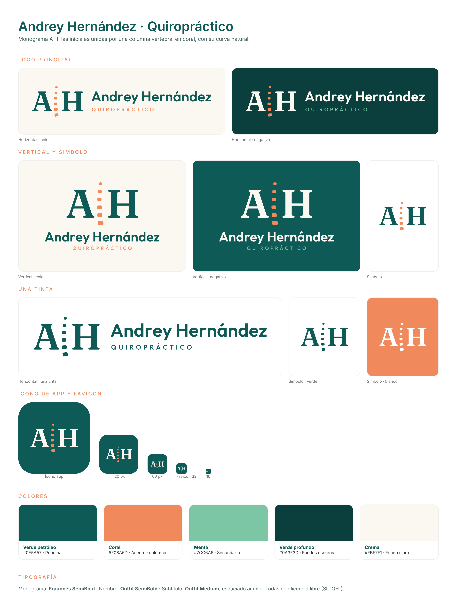

# Marca · Andrey Hernández, Quiropráctico

Monograma **A·H**: las iniciales unidas por una columna vertebral en coral con su curva natural.



## Archivos (`logo/`)

| Archivo | Uso |
|---|---|
| `logo-horizontal-color.svg` | Logo principal sobre fondos claros |
| `logo-horizontal-negativo.svg` | Sobre fondos oscuros (verde profundo) |
| `logo-horizontal-una-tinta.svg` | Impresión a un color, sellos, bordados |
| `logo-vertical-color.svg` / `-negativo.svg` | Espacios cuadrados o verticales (perfil de redes, portada) |
| `simbolo-*.svg` | Solo el monograma (color, negativo, verde, blanco) |
| `icono-app.svg` | Ícono de la app (esquinas redondeadas) |
| `icono-app-maskable.svg` | Ícono Android/PWA "maskable" (a sangre, con zona segura) |
| `favicon.svg` | Pestaña del navegador |
| `png/` | Exportaciones en PNG (íconos 16–1024 px, logos en alta resolución) |

## Colores

| Nombre | Hex | Uso |
|---|---|---|
| Verde petróleo | `#0E5A57` | Principal |
| Coral | `#F08A5D` | Acento · columna |
| Menta | `#7CC6A6` | Secundario |
| Verde profundo | `#0A3F3D` | Fondos oscuros |
| Crema | `#FBF7F1` | Fondo claro |

## Tipografía

- Monograma: **Fraunces SemiBold**
- Nombre: **Outfit SemiBold**
- Subtítulo: **Outfit Medium**, mayúsculas con espaciado amplio

Ambas con licencia SIL Open Font License (uso libre, también comercial).

## Regenerar

```bash
pip install fonttools
python3 marca/herramientas/generar_logo.py
node marca/herramientas/exportar.js
```

`propuestas-logo/` conserva los conceptos iniciales descartados como referencia.
